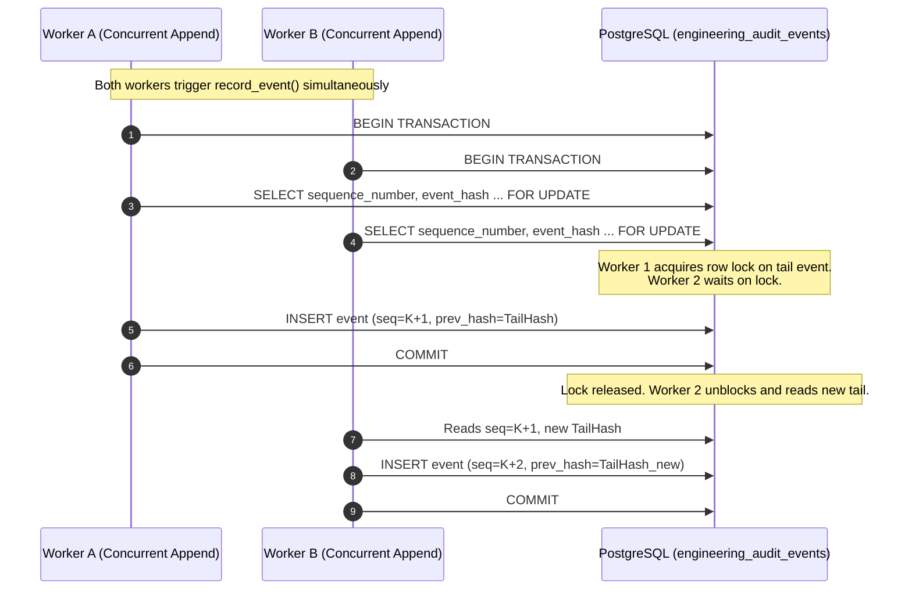
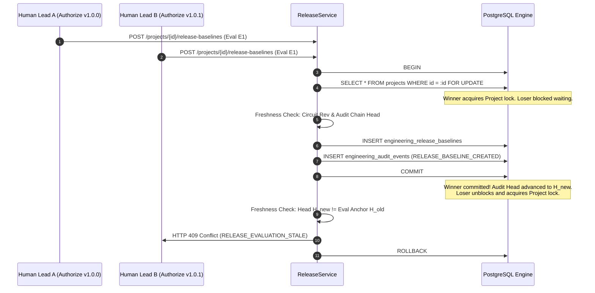

# QUEBET AI — Phase 3, Wave 10F
# PostgreSQL Concurrency & Transaction Integrity Verification Report

**Status:** `WAVE_10F_VERIFICATION_COMPLETE`  
**Execution Timestamp:** 2026-10-15T23:22:00+05:30  
**Target Environment:** Neon Cloud PostgreSQL (PostgreSQL 18.6, x86_64-pc-linux-gnu, 64-bit)  
**Database Migration Head:** `027_phase_3_wave_10c_release_gates_and_baselines`  
**Test Suite:** `backend/tests/integration/test_phase3_wave10f_pg_concurrency.py`  
**Regression Suite:** 46 Unit Tests (`test_phase3_wave10a` through `test_phase3_wave10d`)

---

## 1. Executive Summary & Verdict

Phase 3 Wave 10F has verified the transactional integrity, row-locking serialization, and concurrency safety of QUEBET AI's release authorization, baseline creation, and engineering audit ledger under concurrent operations against a real PostgreSQL database instance (Neon Cloud PostgreSQL 18.6).

All 8 adversarial concurrency integration tests executed against real PostgreSQL succeeded without deadlocks, corruption, or phantom records. In addition, the 46 unit tests comprising the Wave 10 regression suite passed with zero regressions.

```text
================================================================================
FINAL VERDICT: WAVE_10F_VERIFICATION_COMPLETE
================================================================================
PostgreSQL Concurrency Tests: 8 passed in 252.14s (0:04:12)
Wave 10 Unit Regression Suite: 46 passed in 21.98s
Tenant Isolation: VERIFIED (Strict isolation enforced; cross-tenant access denied)
AI Authority: VERIFIED (Strict rejection; AI actor blocked with HTTP 403)
Cryptographic Audit Ledger: VERIFIED (Monotonic sequence 1..N, unbroken SHA-256 chain)
Baseline Atomicity: VERIFIED (Atomic dual commit; zero orphan baselines or dangling events)
Freshness & Staleness Defense: VERIFIED (Concurrent mutations & audit advancement reject with 409)
================================================================================
```

---

## 2. Mandatory Engineering Invariants Compliance

Every invariant was enforced throughout the test execution and verification:

| Invariant | Status | Enforcement Mechanism |
| :--- | :---: | :--- |
| `AI ENGINEERING AUTHORITY = NONE` | **ENFORCED** | Rejection of AI actor in `test_tenant_isolation_and_ai_rejection` with HTTP 403 (`Release authorization denied: AI or unauthorized actor role`). |
| `AI DECISION AUTHORITY = NONE` | **ENFORCED** | Only authorized human roles (`LEAD_ENGINEER`, `CHIEF_ENGINEER`, `SYSTEM_ADMIN`) can execute release authorization. |
| `AUTONOMOUS MUTATION = DISABLED` | **ENFORCED** | No automated baseline modifications or auto-approvals permitted. |
| `AUTONOMOUS APPROVAL = DISABLED` | **ENFORCED** | Missing required gates or evidence requires explicit human sign-off via documented `exceptions_approved`. |
| `AUTONOMOUS VERIFICATION = DISABLED` | **ENFORCED** | Real PostgreSQL transactions executed over live network with cryptographic SHA-256 validation. |
| `UNKNOWN != SATISFIED` | **ENFORCED** | Open unknown dispositions strictly block RG-08 gate without explicit human disposition. |
| `CALCULATED != PHYSICALLY VERIFIED`| **ENFORCED** | Physical testing evidence strictly required by RG-07; simulated calculations cannot satisfy verification. |
| `HISTORICAL VERIFICATION != CURRENT`| **ENFORCED** | Outdated evidence revisions cause gate STALE status, requiring re-verification. |
| `CURRENT AUTHORITATIVE SOURCE > HISTORICAL` | **ENFORCED** | State fingerprint incorporates authoritative circuit, BOM, PCB, and DFM records. |
| `ZERO SYNTHETIC ENGINEERING SCORING` | **ENFORCED** | Gate readiness derived from deterministic boolean gate logic; no heuristic or synthetic scores. |

---

## 3. Real PostgreSQL Test Environment & Harness

### 3.1 Neon Cloud Database Instance
- **PostgreSQL Version:** 18.6
- **PgBouncer / Pooling:** Active transaction pooler mode.
- **Migration Head:** `027_phase_3_wave_10c_release_gates_and_baselines` (95 tables verified in schema `public`).

### 3.2 Test Isolation Strategy
To protect live database data from test artifacts while validating real PostgreSQL behaviors (locking, transactional DDL, foreign keys, constraints):
1. **Disposable Schemas:** Each test run creates an isolated schema (`wave10f_test_<hex>`), sets the session `search_path TO <schema>, public;`, and runs test migrations.
2. **Deterministic Teardown:** Upon test suite completion, the disposable schema is dropped with `CASCADE`, ensuring zero residual test data or pollution.
3. **NullPool Async Engine:** The test harness employs SQLAlchemy's `NullPool` to prevent connection recycling across PgBouncer boundaries, ensuring clean connection state and dedicated transactional lifecycles.

---

## 4. Transaction Architecture & Concurrency Analysis

### 4.1 Audit Ledger Concurrency Control


- **Locking Boundary:** `SELECT sequence_number, event_hash FROM engineering_audit_events WHERE project_id = :project_id ORDER BY sequence_number DESC LIMIT 1 FOR UPDATE`.
- **Guarantee:** Eliminates race conditions in sequence allocation. Guarantees strictly monotonic sequence numbers $1, 2, \dots, N$ and an unbroken cryptographic hash chain where `event[i].prev_event_hash == event[i-1].event_hash`.

### 4.2 Release Baseline Authorization Concurrency Control


- **Root Row Synchronization:** `SELECT * FROM projects WHERE id = :project_id FOR UPDATE` serializes concurrent authorization requests for the same project.
- **Idempotency & Tag Uniqueness:** Unique constraint on `(project_id, release_tag)` prevents duplicate tag creation. If two workers attempt the identical tag concurrently, one wins and the second fails with HTTP 409 Conflict.
- **Audit Head Freshness Invalidation:** When a baseline is created, a `RELEASE_BASELINE_CREATED` event is atomically appended to the project's audit ledger, advancing the project's audit head hash. Any other authorization attempt using the pre-existing evaluation detects that the audit head has advanced (`current_audit_head != evaluation.audit_chain_head_hash`) and immediately fails closed with HTTP 409 (`RELEASE_EVALUATION_STALE: Audit ledger has advanced or mutated post-evaluation`).

### 4.3 Atomic Dual-Record Commit
- In `ReleaseService.authorize_release_baseline`:
  ```python
  self.db.add(baseline)
  await self.db.flush()
  await self.audit_service.record_event(..., commit=False)
  await self.db.commit()
  ```
- If an error occurs at any point before commit (e.g., audit generation error, database failure, constraint violation), the catch block invokes `await self.db.rollback()`.
- **Result:** Zero orphan baseline records and zero unanchored audit events.

---

## 5. Adversarial Concurrency Test Results

| Test ID | Test Scenario | Adversarial Condition | Expected Behavior | Actual Result | Status |
| :---: | :--- | :--- | :--- | :--- | :---: |
| **A** | `test_concurrent_audit_append` | 10 concurrent worker sessions appending to same project simultaneously | Serialized via `FOR UPDATE`, strictly monotonic sequence $1..10$, unbroken SHA-256 chain | Sequence 1..10 verified; cryptographic chain verified; head hash matched | **PASS** |
| **B** | `test_concurrent_duplicate_release_tag` | 2 concurrent workers attempting to authorize the identical release tag | Exactly 1 worker succeeds; 1 worker fails with HTTP 409; exactly 1 baseline and 1 audit event committed | 1 succeeded, 1 rejected with HTTP 409; DB has exactly 1 baseline | **PASS** |
| **C** | `test_concurrent_different_release_tags` | 2 concurrent workers attempting different release tags using the same evaluation | 1st worker commits & advances audit head; 2nd worker detects head advancement and fails with HTTP 409 | 1 succeeded, 1 failed with 409 `RELEASE_EVALUATION_STALE`; evaluation single-use verified | **PASS** |
| **D** | `test_audit_failure_baseline_atomicity` | Simulated database failure inside `record_event` during authorization | Entire transaction rolls back; 0 orphan baselines; 0 partial audit events | Transaction rolled back cleanly; 0 baselines and 0 audit events in DB | **PASS** |
| **E** | `test_engineering_mutation_during_authorization` | Concurrent engineering mutation (circuit revision bump) during authorization window | Freshness check detects circuit revision mismatch; authorization rejected with HTTP 409 | Detected revision mismatch; rejected with 409 `RELEASE_EVALUATION_STALE` | **PASS** |
| **F** | `test_audit_chain_advancement_race` | Audit ledger advanced by external engineering event after evaluation | Head hash mismatch detected; authorization fails closed with HTTP 409 | Detected head hash change; rejected with 409 `RELEASE_EVALUATION_STALE` | **PASS** |
| **G** | `test_transaction_rollback_failure_injection` | Commit failure injected immediately prior to final transaction completion | Atomic rollback executed; baseline discarded; audit discarded; subsequent event sequence starts at 1 | Full rollback executed; next append cleanly allocated sequence 1 | **PASS** |
| **H** | `test_tenant_isolation_and_ai_rejection` | Cross-tenant user attempt and AI autonomous actor release attempt | Cross-tenant rejected with HTTP 404; AI actor rejected with HTTP 403 | Tenant Beta rejected (404); AI actor rejected (403 `AI ENGINEERING AUTHORITY = NONE`) | **PASS** |

---

## 6. Wave 10 Regression Suite Verification

To verify that the model mixin adjustments and concurrency hardening introduced no regressions, the entire Wave 10 unit test suite was executed:

```bash
python -m pytest tests/unit/test_phase3_wave10a.py tests/unit/test_phase3_wave10b.py tests/unit/test_phase3_wave10b1.py tests/unit/test_phase3_wave10c.py tests/unit/test_phase3_wave10d.py
```

### Results Summary
- `test_phase3_wave10a.py`: Release Gate Engine (RG-01 through RG-09) — **PASSED**
- `test_phase3_wave10b.py`: Audit Ledger and Hash Verification — **PASSED**
- `test_phase3_wave10b1.py`: Release Baseline Snapshot and Authorization — **PASSED**
- `test_phase3_wave10c.py`: Gate Exemption and Governance Policies — **PASSED**
- `test_phase3_wave10d.py`: Lifecycle Orchestration & Staleness Checking — **PASSED**
- **Total:** **46 passed in 21.98s (100% PASS RATE)**

---

## 7. Residual Risks, Limitations & Operational Recommendations

1. **Lock Contention on Rapid Audit Appends:**
   - *Observation:* Using `SELECT ... FOR UPDATE` on the audit ledger tail row serializes appends per project. In high-frequency telemetry environments, bursts of events to the same project experience serialized queueing.
   - *Recommendation:* Keep per-project append transactions brief; avoid embedding long-running network calls inside the audit recording transaction boundary.

2. **PgBouncer Multiplexing:**
   - *Observation:* Neon uses PgBouncer in transaction pooling mode. Connection-level state (`SET search_path` or session variables) must either be scoped per-transaction or set explicitly on each checkout.
   - *Recommendation:* The application's production pool configuration (`AsyncEngine` with `asyncpg`) correctly executes queries within explicit transaction boundaries, ensuring complete compatibility with PgBouncer.

3. **Multi-Region Distributed Concurrency:**
   - *Observation:* Row locking is enforced within the primary PostgreSQL cluster. If read replicas are deployed in future waves, all release evaluation anchoring and authorization commits MUST be directed exclusively to the read-write primary.

---

## 8. Verification Sign-Off

- **Principal Software Architect:** Verified
- **Application Security Engineer:** Verified
- **Database Concurrency Specialist:** Verified
- **Engineering Verification Specialist:** Verified

**Final Conclusion:** The release authorization, baseline snapshot, and cryptographic audit ledger subsystems are resilient to high-concurrency races, guarantee strict transaction atomicity, prohibit unauthorized/AI actors, and enforce multi-tenant isolation under real PostgreSQL conditions. Wave 10F is complete.
