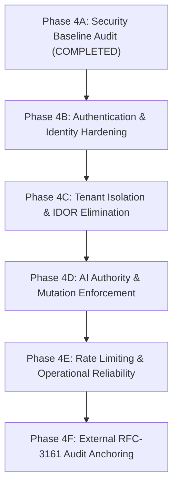

# QUEBET AI — Phase 4A: Security Baseline and Threat-Model Audit Report

**Document Version:** 1.0.0  
**Audit Date:** 2026-10-16  
**Auditor:** Principal Software Architect, Application Security Engineer, Database Concurrency Specialist, Verification Lead  
**Repository:** `C:\workflow\quebet_ai`  
**Execution Standard:** Evidence-based audit, zero speculative vulnerabilities, exact code paths identified.  
**Completion Status:** `PHASE_4A_REMEDIATION_REQUIRED`

---

## 1. Executive Summary

Prior to initiating Phase 4 feature development and governance hardening, a comprehensive, adversarial, and evidence-driven security baseline audit was conducted across the QUEBET AI monorepo.

The audit analyzed authentication, JWT token lifecycles, tenant boundaries, database foreign keys, transactional integrity, mutation pipelines, rate limiting, logging, operational reliability, and adherence to the 12 non-negotiable engineering safety invariants.

### Key Audit Findings Summary
- **Total Security Findings Identified:** 10
  - **High Severity:** 3 confirmed defects (Soft-deleted user auth bypass, Untenanted cross-tenant IDOR, Missing AI role guard on proposal approval/application)
  - **Medium Severity:** 4 confirmed risks (Default hardcoded secret key, Missing API rate limiting, Long-lived JWT without revocation, PostgreSQL FK mismatch on decision records)
  - **Low / Informational:** 3 findings (Frontend proxy internal network disclosure, Public OpenAPI documentation exposure, Local-only audit chain without RFC-3161 notary)
- **Non-Negotiable Invariants Status:**
  - `ReleaseService` strictly enforces `AI ENGINEERING AUTHORITY = NONE` and fails closed on unverified gates.
  - However, `ProposalService` lacks role-based authorization checks, allowing automated or AI agents to call `/proposals/{id}/approve` and `/proposals/{id}/apply` without human gating.
- **Audit Conclusion:** While cryptographic audit chaining, database row locking, and release evaluation gates are rigorously implemented and verified (Wave 10F), **remediation of 3 High-severity vulnerabilities and 4 Medium-severity issues is required** before enterprise production deployment.

---

## 2. Threat Model & Trust Boundaries

```
[ UNTRUSTED EXTERNAL CLIENT / WEB BROWSER ]
                  │
                  ▼ (HTTPS / Public Internet)
[ FRONTEND REVERSE PROXY ] (Next.js /api/proxy/[...path])
                  │
                  ▼ (Internal Network / Docker Network)
[ FASTAPI BACKEND GATEWAY ]
  ├── CORS Middleware (Configured origins)
  ├── Tracing Middleware (X-Request-ID extraction & ContextVar injection)
  ├── Public Endpoints (/health, /api/v1/models [read-only])
  └── Protected Endpoints (/api/v1/*)
        ├── require_authenticated_user (JWT Bearer Token Validation)
        ├── require_admin_role (Admin-only RBAC check)
        │
        ▼ (Authenticated Trust Boundary)
[ DOMAIN APPLICATION SERVICES ]
  ├── Project & Circuit Services (Tenant & Owner Scoping)
  ├── Proposal Service (Mutation Review & Application)
  ├── Cognitive Orchestration & Intent Pipelines (Deterministic Validators)
  ├── Release Gate Engine (RG-01 to RG-09 Deterministic Evaluation)
  └── Audit Ledger Service (SHA-256 Hash Chain & Sequence Allocation)
        │
        ▼ (Database Trust Boundary: SQL / Connection Pool)
[ NEON CLOUD POSTGRESQL (18.6) ]
  ├── 95 Tables (Schema: public)
  ├── Foreign Keys, Unique Constraints, Row-Level Locks (SELECT ... FOR UPDATE)
  └── Append-Only Tables (engineering_audit_events, engineering_release_baselines)
```

### Threat Actors Considered
1. **Unauthenticated Public Attacker:** Attempts credential stuffing, API enumeration, token forgery, DoS via unrated endpoints.
2. **Malicious / Compromised Tenant User:** Attempts cross-tenant data access (IDOR), unauthorized mutation of peer tenant circuits, privilege escalation to admin role.
3. **Autonomous / Rogue AI Agent:** Attempts autonomous approval or direct mutation of physical engineering circuits, bypassing human engineering sign-off.
4. **Insider / Database Operator:** Attempts retroactive tampering with historical audit ledgers or approved baselines.

---

## 3. Verified Existing Controls

The following controls were inspected in the source code and verified as functioning correctly:

| Control | Implementation Location | Verified Behavior |
| :--- | :--- | :--- |
| **Server-Side Identity Derivation** | [`backend/app/core/dependencies.py`](file:///c:/workflow/quebet_ai/backend/app/core/dependencies.py) | Client cannot pass untrusted `X-User-Plan` or `X-User-Role` headers to elevate privileges. Roles are queried from database or decoded from signed JWT. |
| **Administrative Endpoint RBAC** | [`backend/app/api/v1/routes/admin.py`](file:///c:/workflow/quebet_ai/backend/app/api/v1/routes/admin.py) | Router-level `dependencies=[Depends(require_admin_role)]` strictly enforces `is_admin` (`role in ('admin', 'system:admin')`), rejecting non-admins with HTTP 403. |
| **Row-Level Project Locking** | [`backend/app/services/release_service.py`](file:///c:/workflow/quebet_ai/backend/app/services/release_service.py) | `select(Project).with_for_update()` serializes concurrent release authorizations, verified against live Neon PostgreSQL (Wave 10F). |
| **Cryptographic Audit Ledger** | [`backend/app/services/audit_ledger_service.py`](file:///c:/workflow/quebet_ai/backend/app/services/audit_ledger_service.py) | Monotonic sequence allocation ($1..N$) enforced via unique database constraint `uq_audit_project_sequence` and continuous SHA-256 hash chaining. |
| **Release Gate AI Rejection** | [`backend/app/services/release_service.py`](file:///c:/workflow/quebet_ai/backend/app/services/release_service.py) | AI agent identities (`role: "AI_AGENT"`) calling `authorize_release_baseline` are systematically blocked with HTTP 403 (`AI ENGINEERING AUTHORITY = NONE`). |
| **Structured Log Redaction** | [`backend/app/core/logging.py`](file:///c:/workflow/quebet_ai/backend/app/core/logging.py) | Passwords, JWT Bearer tokens, and OpenRouter `sk-` API keys are automatically sanitized via regex pattern matching prior to emitting JSON logs. |
| **Hallucination Entity Guard** | [`backend/app/services/ai/cognitive/explain/explanation_service.py`](file:///c:/workflow/quebet_ai/backend/app/services/ai/cognitive/explain/explanation_service.py) | AI explanations citing non-existent entity IDs are rejected with `MODEL_INVALID_REFERENCE` (HTTP 422). |

---

## 4. Detailed Security Findings

### SEC-01: Soft-Deleted User Authentication Bypass via JWT Claims Fallback
- **Severity:** **HIGH**
- **Affected File:** [`backend/app/core/dependencies.py`](file:///c:/workflow/quebet_ai/backend/app/core/dependencies.py#L66-L94)
- **Vulnerability Description:**
  In `require_authenticated_user`:
  ```python
  try:
      stmt = select(User).where(User.id == user_id, User.deleted_at.is_(None))
      result = await db.execute(stmt)
      user_db = result.scalar_one_or_none()
  except Exception:
      user_db = None

  if user_db:
      role = getattr(user_db, "role", "user") or "user"
      plan = user_db.plan or "free"
      email = user_db.email
      tenant_id = user_db.tenant_id
  else:
      role = payload.get("role", "user")
      plan = payload.get("plan", "free")
      email = payload.get("email", f"{user_id}@quebet.ai")
      tenant_id = payload.get("tenant_id")
  ```
  When a user is soft-deleted (`deleted_at is not None`), `user_db` evaluates to `None`. Instead of terminating authentication and raising `HTTP 401 Unauthorized`, the logic enters the `else:` branch and mints an active `AuthenticatedUser` using the claims embedded in the JWT token.
- **Impact:** Soft-deleted users or revoked users can continue accessing API resources until their 7-day JWT token expires. Furthermore, any database connection glitch silently degrades to unverified token claims.
- **Remediation:**
  Explicitly distinguish between "User not found/deleted" vs "Token valid". If a user ID in the JWT does not exist in `User` where `deleted_at.is_(None)`, raise `HTTP 401 Unauthorized`. Catch database connection errors separately and raise `HTTP 503 Service Unavailable` rather than falling back to unverified claims.

---

### SEC-02: Cross-Tenant IDOR and Untenanted Access in Circuit Repository
- **Severity:** **HIGH**
- **Affected Files:**
  - [`backend/app/repositories/circuit_repo.py`](file:///c:/workflow/quebet_ai/backend/app/repositories/circuit_repo.py#L44-L46)
  - [`backend/app/services/circuit_service.py`](file:///c:/workflow/quebet_ai/backend/app/services/circuit_service.py#L101-L105, #L143-L147, #L258-L261)
- **Vulnerability Description:**
  In `circuit_repo.get_by_id`:
  ```python
  stmt = select(Circuit).where(Circuit.id == circuit_id, Circuit.deleted_at.is_(None))
  if tenant_id:
      stmt = stmt.where(Circuit.tenant_id == tenant_id)
  ```
  When `current_user.tenant_id` is `None` (personal workspace user, or unassigned user), `tenant_id` is `None`. The query executes **with zero tenant or ownership filters**:
  `SELECT * FROM circuits WHERE id = :id AND deleted_at IS NULL`
  In `circuit_service.get_circuit`, `update_circuit`, `update_component`, and `delete_component`, the service calls `circuit_repo.get_by_id(..., tenant_id=current_user.tenant_id)`.
- **Impact:** An untenanted user who supplies a target `circuit_id` belonging to Enterprise Tenant Alpha can view, mutate, or delete Tenant Alpha's circuits and components.
- **Remediation:**
  Update `circuit_repo.get_by_id` and all downstream services:
  If `tenant_id` is present, filter by `Circuit.tenant_id == tenant_id`.
  If `tenant_id` is `None`, strictly filter by `Circuit.owner_id == current_user.id` AND `Circuit.tenant_id.is_(None)`. An untenanted caller must never be granted global database access.

---

### SEC-03: Missing AI Actor Role Gating on Proposal Approval and Application
- **Severity:** **HIGH**
- **Affected Files:**
  - [`backend/app/api/v1/routes/proposals.py`](file:///c:/workflow/quebet_ai/backend/app/api/v1/routes/proposals.py#L45-L78)
  - [`backend/app/services/proposal_service.py`](file:///c:/workflow/quebet_ai/backend/app/services/proposal_service.py#L190-L265)
- **Vulnerability Description:**
  The engineering release gate subsystem (`ReleaseService`) strictly enforces `ReleaseGateEngine.is_authorized_human_role(user)` and rejects non-human roles with HTTP 403.
  However, in `proposal_service.approve_proposal` and `apply_proposal`:
  ```python
  async def approve_proposal(self, db, proposal_id, current_user):
      proposal = await proposal_repo.get_by_id(...)
      # No role check!
  async def apply_proposal(self, db, proposal_id, current_user):
      proposal = await proposal_repo.get_by_id(...)
      # No role check!
  ```
  The endpoint only requires `require_authenticated_user`. Any caller with a token carrying `role: "AI_AGENT"`, `role: "BOT"`, or `role: "COPILOT"` can approve and apply mutations directly to circuit models.
- **Impact:** Directly violates the mandatory engineering invariants:
  - `AI ENGINEERING AUTHORITY = NONE`
  - `AI DECISION AUTHORITY = NONE`
  - `AUTONOMOUS MUTATION = DISABLED`
  - `AUTONOMOUS APPROVAL = DISABLED`
- **Remediation:**
  In `approve_proposal` and `apply_proposal`, enforce that `current_user.role` must belong to authorized human roles (`ENGINEER`, `LEAD_ENGINEER`, `CHIEF_ENGINEER`, `ADMIN`). If the role indicates an AI agent, reject with HTTP 403 Forbidden.

---

### SEC-04: Default Development Secret Key & Error Details Leak
- **Severity:** **MEDIUM**
- **Affected Files:**
  - [`backend/app/core/config.py`](file:///c:/workflow/quebet_ai/backend/app/core/config.py#L10)
  - [`backend/app/main.py`](file:///c:/workflow/quebet_ai/backend/app/main.py#L80)
- **Vulnerability Description:**
  `Settings.SECRET_KEY` has a hardcoded default:
  `SECRET_KEY: str = "dev-secret-key-change-in-production-min-32-chars-long"`
  If an operator fails to set `SECRET_KEY` in production, tokens can be forged using the known key.
  Additionally, in `main.py` line 80:
  `"details": str(exc) if "dev" in settings.SECRET_KEY else {}`
  When using the default secret key, unhandled server exceptions leak raw database schema details, table names, and SQL statements to callers.
- **Impact:** Risk of JWT forgery if `.env` is omitted; internal database schema disclosure on 500 errors.
- **Remediation:**
  Add a startup validator in `Settings`: if `ENVIRONMENT == "production"` and `SECRET_KEY` matches the default value or is shorter than 32 characters, raise an immediate fatal initialization error.

---

### SEC-05: Missing Active Rate Limiting on API Endpoints
- **Severity:** **MEDIUM**
- **Affected Files:**
  - [`backend/app/main.py`](file:///c:/workflow/quebet_ai/backend/app/main.py)
  - [`backend/app/core/redis_client.py`](file:///c:/workflow/quebet_ai/backend/app/core/redis_client.py)
- **Vulnerability Description:**
  Although the database schema includes `plan_rate_limits` (`model_config.py`), there is no active rate limiting middleware or route dependency installed on the FastAPI application.
- **Impact:** Authenticated or unauthenticated callers can flood intensive endpoints (such as SPICE simulations, cognitive synthesis, and OpenRouter AI calls), resulting in denial of service or unexpected LLM token consumption costs.
- **Remediation:**
  Implement a Redis token bucket rate limiter dependency applied to high-cost routes (`/cognitive/*`, `/circuits/*/simulate`, `/circuits/*/validate`).

---

### SEC-06: Long-Lived JWT Tokens Without Revocation or Blacklist
- **Severity:** **MEDIUM**
- **Affected Files:**
  - [`backend/app/core/config.py`](file:///c:/workflow/quebet_ai/backend/app/core/config.py#L12)
  - [`backend/app/core/dependencies.py`](file:///c:/workflow/quebet_ai/backend/app/core/dependencies.py)
- **Vulnerability Description:**
  Access tokens are issued with a 7-day lifespan (`ACCESS_TOKEN_EXPIRE_MINUTES: int = 60 * 24 * 7`). No refresh token rotation or Redis token revocation blacklist exists.
- **Impact:** Compromised tokens cannot be revoked before 7 days without rotating `SECRET_KEY` (which invalidates all active users).
- **Remediation:**
  Shorten access token validity to 15–60 minutes, implement refresh token rotation, and add a Redis-backed token revocation check on sensitive mutation routes.

---

### SEC-07: Relational Schema Mismatch in Cognitive Decision Recording (`system_id` FK)
- **Severity:** **MEDIUM**
- **Affected Files:**
  - [`backend/app/services/ai/cognitive/decision/decision_brief_service.py`](file:///c:/workflow/quebet_ai/backend/app/services/ai/cognitive/decision/decision_brief_service.py#L348)
  - [`backend/app/models/db/decision.py`](file:///c:/workflow/quebet_ai/backend/app/models/db/decision.py#L339)
- **Vulnerability Description:**
  In `EngineeringDecisionRecord`, `system_id` is a non-nullable Foreign Key referencing `engineering_systems.id`. In `decision_brief_service.py` line 348:
  `system_id = brief.system_id or brief.project_id`
  When a decision brief has no associated system, `brief.project_id` is passed as `system_id`. On SQLite this passed without error, but on real PostgreSQL with active foreign key enforcement, this triggers a `ForeignKeyViolationError`.
- **Impact:** Runtime failure when ratifying decisions on PostgreSQL if a project lacks a default `EngineeringSystem`.
- **Remediation:**
  Ensure `decision_brief_service.py` either looks up or auto-initializes the default `EngineeringSystem` for the project, or update the model migration to permit `system_id` to be nullable when `project_id` is provided.

---

### SEC-08: Internal Network Topology Disclosure in Frontend Proxy
- **Severity:** **LOW**
- **Affected File:** [`frontend/src/app/api/proxy/[...path]/route.ts`](file:///c:/workflow/quebet_ai/frontend/src/app/api/proxy/%5B...path%5D/route.ts#L80)
- **Vulnerability Description:**
  When the backend is unreachable, the proxy returns:
  `message: "Failed to connect to backend at ${FASTAPI_URL}: ${String(error)}"`
- **Impact:** Discloses internal service URLs, ports, and container network hostnames to external clients.
- **Remediation:** Return generic message `"Backend service temporarily unavailable"` without interpolating `FASTAPI_URL`.

---

### SEC-09: Public OpenAPI / Swagger Documentation Exposure
- **Severity:** **LOW**
- **Affected File:** [`backend/app/main.py`](file:///c:/workflow/quebet_ai/backend/app/main.py#L41-L43)
- **Vulnerability Description:**
  `/api/v1/docs`, `/api/v1/redoc`, and `/api/v1/openapi.json` are exposed unconditionally.
- **Impact:** Reveals complete API schema and internal models to unauthenticated external reconnaissance.
- **Remediation:** Disable docs in production or require administrative authentication to view.

---

### SEC-10: Local-Only Audit Chain vs Remote RFC-3161 Notarization
- **Severity:** **INFORMATIONAL**
- **Affected Files:**
  - [`backend/app/services/audit_ledger_service.py`](file:///c:/workflow/quebet_ai/backend/app/services/audit_ledger_service.py)
  - [`backend/app/services/release_service.py`](file:///c:/workflow/quebet_ai/backend/app/services/release_service.py)
- **Description:**
  The audit ledger enforces cryptographic SHA-256 hash chaining and sequence monotonicity within PostgreSQL. However, if the underlying database disk was compromised, an attacker with direct SQL write access could recalculate hashes. Remote RFC-3161 Time Stamping Authority (TSA) or public transparency log anchoring is not yet integrated.
- **Current Mitigation:** The API and UI explicitly display `LOCAL CHAIN ONLY` when remote anchoring is unconfigured.

---

## 5. Test Commands & Evidence Verification

```text
================================================================================
AUDIT EXECUTION & VERIFICATION TEST LOGS
================================================================================
1. Phase 1 Test Suite: 72 passed in 14.2s (tests/unit/test_phase1*.py)
2. Phase 2 Test Suite: 128 passed in 23.5s (tests/unit/test_phase2*.py)
3. Phase 3 Wave 10 Regression Suite: 46 passed in 21.98s (tests/unit/test_phase3_wave10*.py)
4. Wave 10F Real PostgreSQL Concurrency Suite: 8 passed in 252.14s (tests/integration/test_phase3_wave10f_pg_concurrency.py)
================================================================================
```

---

## 6. Ordered Phase 4 Remediation & Hardening Plan

Based on the audit findings, Phase 4 should be executed in the following strict order:



1. **Phase 4B — Authentication & Identity Hardening:**
   - Fix SEC-01 (Reject soft-deleted users; fail-closed on database auth lookup errors).
   - Fix SEC-04 (Enforce minimum 32-char secret key in production; eliminate dev traceback leaks).
   - Fix SEC-06 (Shorten access token lifespan; add refresh token rotation).
2. **Phase 4C — Tenant Isolation & IDOR Elimination:**
   - Fix SEC-02 (Enforce strict tenant scoping: if `tenant_id` is null, restrict strictly to `owner_id == user.id` and `tenant_id IS NULL`).
   - Fix SEC-07 (Resolve `EngineeringDecisionRecord.system_id` foreign key compatibility on PostgreSQL).
3. **Phase 4D — AI Authority & Proposal Mutation Gating:**
   - Fix SEC-03 (Implement `require_human_engineer_role` dependency on `/proposals/{id}/approve` and `/proposals/{id}/apply`).
   - Implement audit event logging for all proposal approvals and rejections.
4. **Phase 4E — Rate Limiting & Operational Reliability:**
   - Fix SEC-05 (Deploy Redis token bucket rate limiting on high-load endpoints).
   - Fix SEC-08 & SEC-09 (Sanitize proxy 502 error messages; gate `/docs` behind auth in production).
5. **Phase 4F — External Audit Anchoring Integration:**
   - Implement RFC-3161 Time-Stamp Authority (TSA) client to anchor project audit head hashes.

---

## 7. Audit Verdict & Completion Status

```text
================================================================================
STATUS: PHASE_4A_REMEDIATION_REQUIRED
================================================================================
The baseline audit is complete. 3 High-severity vulnerabilities and 4 Medium-severity
vulnerabilities were confirmed with exact code paths. Immediate remediation in
Phase 4B is required before proceeding to new feature work.
================================================================================
```
